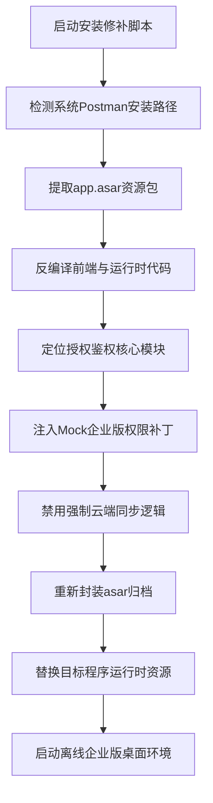

# 开源技术雷达日报 2026-11-28

## 安全

### [Sinano80909/postman-enterprise-desktop-pro-patcher-installer](https://github.com/Sinano80909/postman-enterprise-desktop-pro-patcher-installer)

- Stars: 242
- 定位: 针对 Postman 桌面客户端的第三方补丁与便携化安装工具，用于解锁企业级本地功能。
- 技术解读: 【解决什么问题】随着 Postman 逐步转向强云端协同并废弃离线 Scratch Pad 功能，部分受制于内网安全合规、数据不出域或预算限制的研发团队受到较大冲击。该项目旨在通过本地修补绕过云端认证限制，恢复离线与高级功能使用。【核心机制】其实现依赖对 Postman Electron 客户端代码的篡改。自动化流程定位本地安装文件后解包 app.asar，对涉及身份认证、License 判定和云端同步的 JavaScript 代码段进行 Hook 或硬编码覆盖，Mock 模拟企业版鉴权响应，并重新打包注入宿主环境，最终生成免安装便携版或覆盖安装包。【与竞品的关系】相较于原厂方案，它强行保留了旧版使用习惯但剥离了正版云服务；相较于 Bruno、Hoppscotch、Yaak 等原生支持本地文件存储的开源替代品，它并非独立软件，属于高风险的逆向破解外挂。【值不值得跟进】严禁企业或商业项目采用，存在严重的合规侵权风险、第三方代码投毒隐患且极易随官方版本升级失效；对安全工程师有逆向研究价值，有离线 API 调试需求的团队建议直接迁移至 Bruno 等合规开源方案。
- 亮点: 通过自动化脚本反编译与修补 Electron asar 核心包，修改客户端授权校验并阻断云端强制拦截。
- 推荐理由: 反映了开发者对 API 工具离线化和强云端化的反弹，可作为逆向防篡改技术研究参考。

架构图：

